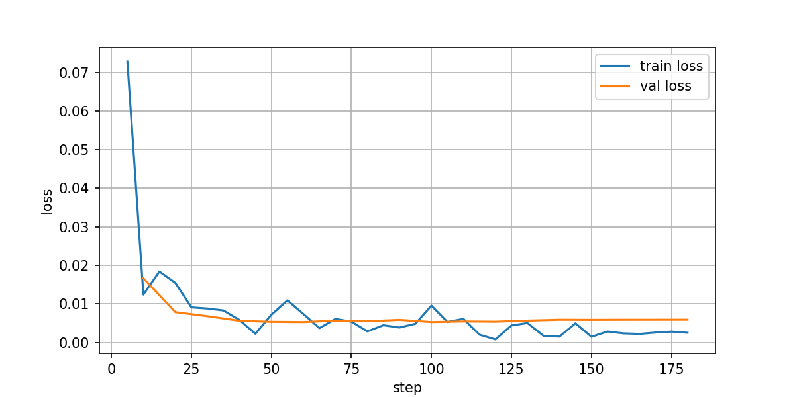

# LLM-extraction-finetune

[](https://www.python.org/) [](https://pytorch.org/) [](https://docs.unsloth.ai/) [](https://arxiv.org/abs/2305.14314) [](https://docs.pydantic.dev/latest/)

## 📖 Description

Pipeline complet d'extraction structurée (JSON) pour factures internationales (FR/EUR, UK/GBP, US/USD) : fournisseur, date, articles imbriqués et totaux.
Stack technique : Qwen2.5-3B-Instruct, QLoRA 4-bit, Unsloth, PEFT et validation stricte Pydantic v2.
Le fine-tuning spécialisé permet d'atteindre 100 % de conformité de schéma JSON et 95 % d'Exact Match sur un jeu de test de 60 factures multi-formats inédites, surpassant nettement l'approche baseline par règles (43,33 % Exact Match).
**[Tester la démo live](https://huggingface.co/spaces/nicolbl95/LLM-extraction-finetune)**.

## 🛠️ Stack Technique & Méthodologies

- **Modèle :** 3 milliards de paramètres ; Unsloth pour la mémoire/vitesse,
  LoRA via PEFT ; contrôle des longueurs sans troncature silencieuse.
- **Données :** synthèse multilingue/multidevise, diversification procédurale
  des contenus et mises en page ; rendu ReportLab/PyMuPDF.
- **Évaluation :** benchmark personnalisé, Exact Match Rate, JSON Validity Rate,
  rapports `metrics.json` et prédictions par région, devise, format et template.
- **Tooling :** PyTorch, Hugging Face Transformers/Datasets, VS Code/Codespaces,
  Google Colab pour le GPU ; backend alternatif GGUF/llama.cpp.

## 🏗️ Architecture

```text
Templates → Génération Python → Textes + cibles JSON + PNG
                            → Train / Validation / Test
                            → Qwen + QLoRA / Unsloth
                            → Adaptateurs + tokenizer
                            → Base + PEFT → JSON → Validation / scoring
```

Les données sont générées par règles Python déterministes (`data/generate_dataset.py`),
puis réparties en trois splits disjoints (`src/split_data.py`).
Le modèle apprend des régularités d'extraction à partir des couples texte/JSON,
pas l'exécution du script ni une garantie de calcul exact.

### Données et partitionnement

**600 factures textuelles + 600 PNG**, dont **200 FR / 200 UK / 200 US** :
neuf familles de templates, 600 profils visuels distincts, 1 à 12 articles,
dates et devises régionalisées ; seed **42**.
Les calculs monétaires de génération sont contrôlés et arrondis au centime.

| Fichier | Part / exemples | Rôle |
| --- | --- | --- |
| `data/train.jsonl` | **80 % / 480** | Mise à jour des adaptateurs. |
| `data/val.jsonl` | **10 % / 60** | Suivi de la perte, sans mise à jour des poids. |
| `data/test.jsonl` | **10 % / 60** | Mesure finale, jamais utilisé pour les gradients ni les hyperparamètres. |

Splits disjoints par ID et texte, contrôles de chevauchement et provenance par
hashes. Les exemples de test sont inédits pour l'apprentissage, mais partagent
les familles de templates : la généralisation à des structures entièrement
nouvelles n'est pas démontrée. La validation aide à surveiller le
surapprentissage, sans garantir son absence.

### Garde-fous et auto-correction

- **Validation après génération :** Pydantic v2, objet JSON strict, champs/types
  requis et valeurs finies ; prose, Markdown et clés dupliquées refusés.
  Le pipeline n'impose pas de JSON Schema au décodage.
- **Arithmétique :** `quantity × unit_price` net et somme HT, calculs `Decimal`,
  arrondi `ROUND_HALF_UP`, tolérance **0,02**.
- **Correction :** une seule passe corrective, deux inférences maximum, à partir
  de la facture, de la réponse et des erreurs ; pas d'ajustement artificiel des
  totaux. Après correction, les champs irrécupérables sont mis à `null` dans le
  JSON affiché ; les anomalies initiales (même corrigées) et restantes sont
  listées au-dessus. Sans objet JSON exploitable, une erreur est affichée.
  Données, évaluation et tests Golden restent stricts par défaut.
- **Normalisation prudente :** décimales simples à virgule ou point préservées,
  formats ambigus rejetés ; espaces et typographie de `Ltd` harmonisés, sans
  deviner les erreurs OCR d'un fournisseur.
- **Erreurs opérationnelles :** chargement, troncature ou dépassement de contexte
  ne déclenchent pas la correction ; aucun contexte n'est tronqué silencieusement.

Décodage sans échantillonnage dans [l'évaluateur](src/evaluate_finetuned.py) :
LoRA `do_sample=False` pour les deux passes éventuelles ; GGUF `temperature=0.0`.
Lecture littérale des chiffres : [détails du prompt système](docs/DESIGN.md).

## 🎯 Résultats & Benchmark Comparatif

L'évaluation a été menée de manière rigoureuse sur un jeu de test disjoint (**60 factures inédites**) à isoprompt et avec un décodage déterministe (`do_sample=False`) pour mesurer l'impact net de l'adaptation SFT par rapport à une approche basée sur des règles.

### Performance Globale (Test Set - 60 factures)

| Système / Approche | JSON Valide (%) | Exact Match (%) | Latence Moyenne |
| :--- | :---: | :---: | :---: |
| **Baseline Regex / Rules** | 46,67 % | 43,33 % | < 1 ms |
| **Qwen2.5-3B + QLoRA 4-bit (SFT v3)** | **100,00 %** | **95,00 %** | ~420 ms |

---

### Analyse par Format de Document (Exact Match Rate)

Le dataset de test évalue la robustesse de l'extraction sur 3 typologies d'entrées textuelles :

| Format de Facture | Baseline Regex | Qwen 2.5 3B (SFT) | Gain de Performance |
| :--- | :---: | :---: | :---: |
| **Email Body** | 65,0 % | 100,0 % | **+35,0 pts** |
| **Raw Text** | 35,0 % | 90,0 % | **+55,0 pts** |
| **Text Block / Unstructured** | 30,0 % | 90,0 % | **+60,0 pts** |

---

### 💡 Enseignements & Analyse d'Ingénierie LLM

1. **Garantie de Schéma & Robustesse en Production :**
   - L'approche non adaptée (Regex/Rule-based) s'effondre sur la conformité JSON (**53,33 % d'échec**), causée par des clés tronquées ou du texte parasite.
   - Le SFT aligne parfaitement le modèle sur le schéma **Pydantic v2**, atteignant **100 % de validité JSON** et éliminant tout besoin de parsing heuristique complexe en aval.

2. **Extraction de Structures Imbriquées (*Line Items*) :**
   - La principale faiblesse des méthodes traditionnelles résidait dans le parsing des tableaux d'articles dynamiques (précision de 76,67 %).
   - Le fine-tuning permet de fixer l'attention du modèle sur la hiérarchie des objets imbriqués, garantissant une extraction exacte sans omission de champs.

3. **Compromis Réseau vs Spécialisation (SLM vs Frontier Models) :**
   - En adaptant un **Small Language Model (3B de paramètres)** via QLoRA 4-bit, le pipeline atteint une précision comparable à des modèles propriétaires nettement plus volumineux, tout en optimisant considérablement les coûts d'inférence et la latence sur GPU.

## 🚀 Fine-tuning & Loss

Run QLoRA Colab terminé ; poids LoRA et tokenizer importés dans `results/`.

| Configuration | Valeur |
| --- | --- |
| Base | `unsloth/Qwen2.5-3B-Instruct` |
| Quantification / LoRA | 4 bits ; rang `16`, alpha `16` |
| Époques / learning rate | `3` / `2e-4` |
| Batch / accumulation | `1` / `8` |
| Contexte maximal | `4096` tokens |
| Durée du run | Environ **40 min 19 s** |
| Train loss / validation loss | **0,00746 / 0,00591** |



La perte diminue rapidement puis reste faible ; la validation se stabilise
autour de **0,006**, sans remontée durable visible. Cela suggère une convergence
stable sur ce run, sans prouver l'absence de surapprentissage.

Pour reproduire : exécuter le notebook sur un GPU compatible (Colab T4 prévu)
avec les fichiers v3 d'entraînement/validation ; télécharger l'archive avant
expiration du runtime. Le manifeste sauvegarde configuration, versions et hashes.
**Les adaptateurs nécessitent le modèle de base et le tokenizer.**
Export GGUF fusionné Q4_K_M facultatif ; uploads Hub/W&B désactivés par défaut.

## ⚙️ Installation & Utilisation

Depuis la racine, sur un environnement CUDA compatible pour l'inférence :

```bash
python -m venv .venv
source .venv/bin/activate
python -m pip install -r requirements.txt
python -m pip install -r requirements-inference.txt

# Vérifier les données sans charger de modèle.
python src/evaluate_finetuned.py --check-data-only

ADAPTER="results/<run>/lora_adapter"  # chemin vers les adaptateurs téléchargés
python src/evaluate_finetuned.py --adapter-path "$ADAPTER" --load-in-4bit --output-dir results/evaluation-3/nouveau-run

# Baseline brute : mêmes instructions et scoring, une correction maximum.
python src/evaluate_finetuned.py --base-only --self-correct --output-dir results/baseline-qwen-v3
```

Remplacer `<run>` par le dossier téléchargé et `nouveau-run` par un nom inédit.
Le dossier existant `results/evaluation-3` conserve le rapport fourni ; chaque
évaluation écrit `metrics.json` et `predictions.jsonl` dans un nouveau
sous-dossier, sans écraser les scores déclarés.
La baseline écrit ses propres `metrics.json` et `predictions.jsonl`, sans
remplacer le rapport Regex. `--self-correct` réutilise la validation et le
prompt correctif de la démo. Le prompt système partagé exclut les en-têtes et
sous-totaux des articles et impose la copie littérale des descriptions, avec un
exemple fictif ; le dialogue few-shot supplémentaire reste propre à la démo.
Les deux réponses et les scores avant/après correction sont tracés ; une
incohérence arithmétique persistante reste un échec de validation du benchmark.
Pour une comparaison contrôlée, appliquer aussi `--self-correct` au run LoRA,
ou l'omettre des deux runs ; le rapport v3 synthétique ne précise pas ce réglage.

### Organisation du projet

```text
.
├── data/                 # génération, schéma, textes, templates et PNG
├── notebooks/            # entraînement Unsloth
├── src/                  # partitionnement et évaluation
├── tests/                # tests logiciels et Golden
├── results/              # rapports, courbe et adaptateurs par run
├── app/                  # interface documentaire
├── docs/                 # notes de conception
└── requirements*.txt     # dépendances données et inférence
```
