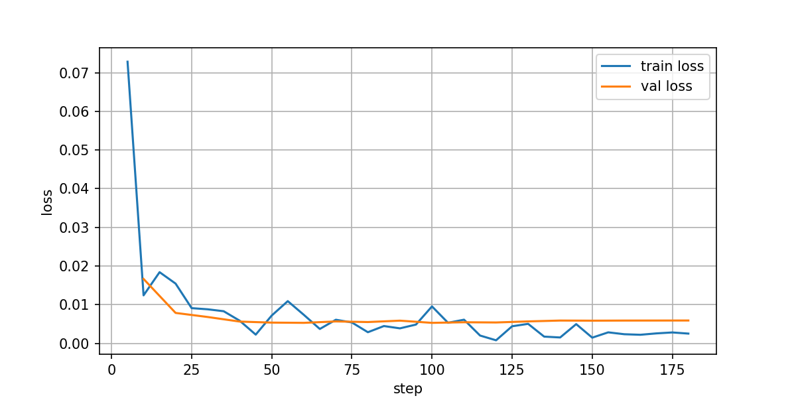

# LLM-extraction-finetune

[](https://www.python.org/) [](https://www.gradio.app/) [](https://tesseract-ocr.github.io/) [](https://opencv.org/) [](https://docs.pydantic.dev/latest/)

**Démo publique : <https://nicolbl95-llm-extraction-finetune.hf.space>**

## 📖 Ce que fait le projet

Le projet transforme une facture (PDF ou image) en **JSON structuré validé** — fournisseur,
date, totaux et lignes d'articles — accompagné d'un **rapport de vérification** qui distingue
les champs confirmés, les anomalies documentées et les champs que le document ne permet pas de
vérifier. Les factures couvertes sont de types FR/EUR, UK/GBP et US/USD.

La version déployée publiquement, comme l'application locale, est un **pipeline OCR
déterministe** : Tesseract (`fra` + `eng`), cinq familles de prétraitement d'image, recoupement
des lectures entre elles, contrôles arithmétiques en `Decimal` et validation stricte Pydantic v2.
**Qwen et LoRA ne sont pas utilisés pour l'extraction dans cette version.** Une variante
fine-tunée a pourtant été développée et mesurée (section « Historique ») ; elle n'est pas
exécutée par la démo publique.

Trois principes gouvernent le pipeline et expliquent la plupart des choix techniques :

- **Ne jamais inventer.** Une valeur absente des preuves documentaires sort `null` — pas une
  moyenne, pas un arrangement arithmétique. Une récupération ne reprend que des valeurs déjà
  présentes dans le document, et seulement quand les contraintes laissent une solution unique.
- **Être fidèle au document.** Une valeur imprimée et lisible est conservée **même si le calcul
  de la facture est faux**. L'anomalie est signalée séparément dans le rapport, elle ne réécrit
  pas le résultat.
- **Borner le travail.** Cinq familles de prétraitement, deux segmentations Tesseract par
  famille, et un budget partagé de **45 s par document**, pages comprises.

## 🧾 Sortie attendue : les champs du JSON

Le schéma de production est défini dans [`data/schema.py`](data/schema.py) (Pydantic v2,
`allow_inf_nan=False`). Ce sont les noms exacts exportés et scorés :

| Champ | Type | Signification |
| --- | --- | --- |
| `supplier_name` | texte | nom du fournisseur copié du document, espaces réduites et suffixe « Limited » normalisé en « Ltd » ([`src/invoice_evidence.py:1393`](src/invoice_evidence.py#L1393)) ; un suffixe OCR ambigu ou un nom contradictoire sort `null` — aucune substitution approximative |
| `invoice_date` | date ISO `YYYY-MM-DD` | date d'émission ; l'échéance est analysée à part et n'est pas exportée |
| `total_ht` | nombre | total **net** de la facture |
| `total_ttc` | nombre | total **toutes taxes comprises** |
| `line_items` | liste | articles du tableau, dans l'ordre imprimé |

Et pour chaque ligne :

| Champ | Type | Signification |
| --- | --- | --- |
| `description` | texte | libellé de la ligne, copié tel quel |
| `quantity` | nombre | quantité imprimée |
| `unit_price` | nombre | **prix unitaire net** |
| `total_ht` | nombre | **montant net de la ligne** — c'est le nom du champ, y compris sur une facture anglophone |

```json
{
  "supplier_name": "Exemple fictif",
  "invoice_date": "2026-10-21",
  "total_ht": 90.0,
  "total_ttc": 108.0,
  "line_items": [
    {"description": "Prestation exemple", "quantity": 7.2, "unit_price": 12.5, "total_ht": 90.0}
  ]
}
```

Ce qui n'est **pas** dans ce JSON, volontairement : la devise, les taux et montants de TVA, les
références de ligne, les dates d'échéance et les adresses. Ils remontent dans le **statut compact**
affiché à l'écran (anomalie, champ non vérifié, limite de lecture) et dans les diagnostics internes,
mais ne font pas partie du contrat de sortie scoré.

Un champ non confirmé sort à `null`. La variante exportée du schéma (`InvoiceResult`,
`safe_invoice_payload`) rend chaque champ nullable, ce qui permet de publier une extraction
partielle honnête plutôt qu'un objet complet rempli de devinettes ; chaque neutralisation est
enregistrée avec sa raison — champ, message de validation et valeur remplacée ([`data/schema.py:147`](data/schema.py#L147)).

## 🌐 Démo publique

L'Espace Hugging Face ([`nicolbl95-llm-extraction-finetune.hf.space`](https://nicolbl95-llm-extraction-finetune.hf.space),
aussi accessible depuis [huggingface.co/spaces](https://huggingface.co/spaces/nicolbl95/LLM-extraction-finetune))
exécute le même code que l'application locale, avec `INVOICE_MODEL=0` : **aucun modèle de
langage n'est chargé**, aucun poids n'est téléchargé.

Ce qu'on y fait :

1. choisir une des trois factures **synthétiques** d'exemple — *France · EUR*,
   *Royaume-Uni · GBP*, *États-Unis · USD* ;
2. lancer l'extraction et voir l'aperçu du document ;
3. lire le **statut compact** : nombre de champs recoupés, anomalies à vérifier, articles non
   reconnus, limitations regroupées lorsqu'elles ont la même cause ;
4. consulter le **JSON structuré**, puis le copier ou le télécharger depuis le bloc de code ;
5. comparer la **durée réellement mesurée** de la lecture, affichée dans le bloc Performances.

Ce qu'elle n'est **pas** :

- **Ce n'est pas un service confidentiel de traitement de factures réelles.** Le téléversement
  libre y est désactivé, et ce n'est pas un simple avertissement : un middleware ASGI
  (`SyntheticUploadStagingGuard`, [app/main.py:233](app/main.py#L233)) refuse toute pièce jointe
  non listée **avant** que Gradio n'écrive un octet sur le disque. Le parseur multi-parties de
  Gradio écrit directement dans le dossier servi, donc un refus postérieur — comme celui de
  `checked_path`, qui ne voit le fichier qu'une fois écrit — aurait laissé le document
  téléchargeable par URL publique pendant toute la durée du cache.
- **Le résultat n'est pas exposé en lecture non plus.** La route fichier de Gradio
  (`/gradio_api/file=`) ne vérifie que l'appartenance au dossier servi, jamais la session : le
  JSON est donc sérialisé **en mémoire** (composant `gr.Code`) et n'est jamais écrit dans un
  dossier accessible par URL.
- **L'isolation entre visiteurs n'est pas démontrée.** Un Space public reste une infrastructure
  tierce, et les fichiers de l'application y sont temporaires mais partagés. N'y soumettez que
  des factures synthétiques, publiques, ou que vous êtes explicitement autorisé à partager.
- Les documents traités sont des **fac-similés générés pour ce dépôt** : fournisseurs, montants
  et identifiants y sont fictifs.

## 🏗️ Architecture : les sept étapes du pipeline

Entrée unique : [`app/main.py`](app/main.py) → `extract_invoice()`. La politique de lecture
(familles, seuils, budget) est définie une seule fois dans
[`src/ocr_config.py`](src/ocr_config.py), versionnée sous
`ocr-policy-5-bounded-fastpath-quota`, et empreintée dans les résultats.

| # | Étape | Où | Ce qui est réellement fait |
| --- | --- | --- | --- |
| 1 | **Acquisition** | [`app/main.py`](app/main.py) | PDF rendu page par page avec PyMuPDF (10 pages, 20 Mo, 25 Mpx max), PNG/JPG autrement. Un PDF à couche texte native et un PDF scanné sont deux chemins distincts. |
| 2 | **Lecture OCR** | [`src/ocr_preprocessing.py`](src/ocr_preprocessing.py), [`src/ocr_recovery.py`](src/ocr_recovery.py), [`src/ocr_budget.py`](src/ocr_budget.py) | Tesseract `fra+eng` en TSV positionné, en niveaux de gris. Chemin propre en deux lectures distinctes (gris redressé PSM 4 / CLAHE PSM 6) ; les cinq familles `deskew`, `clahe`, `crop`, `denoise`, `scale3` ne sont escaladées qu'en cas de doute, sous le budget de 45 s partagé entre les pages. |
| 3 | **Recoupement des lectures** | [`src/ocr_consensus.py`](src/ocr_consensus.py) | Accord **par région et par champ** entre familles de prétraitement distinctes — pas des votes d'un même moteur. Une contradiction ne devient jamais une valeur par défaut : elle devient « non vérifiée ». |
| 4 | **Identification des champs et des lignes** | [`src/invoice_evidence.py`](src/invoice_evidence.py) | Preuve strictement documentaire : positions, nombres sensibles à la locale (`1 234,56` / `1,234.56`), cellules de tableau, taxes, dates. |
| 5 | **Association quantité / prix / montants** | [`src/invoice_grounding.py`](src/invoice_grounding.py) | Ancrage par cellule numérique : une valeur n'est retenue que si ses opérandes sont lisibles et cohérentes. Un montant TTC de ligne ne devient jamais un montant HT ; quand les opérandes manquent et que la TVA est imprimée, la ligne s'abstient plutôt que d'exporter un net recalculé. L'inverse est vrai aussi : un montant de ligne imprimé et corroboré par le total HT du document reste conservé quand le produit quantité × prix a été rejeté, parce que le blâme reste indéterminé ([`src/invoice_grounding.py:557`](src/invoice_grounding.py#L557)). |
| 6 | **Contrôles de cohérence** | [`src/invoice_validation.py`](src/invoice_validation.py), [`data/schema.py`](data/schema.py) | `quantity × unit_price = total_ht` par ligne, somme des HT de lignes = HT global, HT + TVA lue = TTC (plusieurs taux). Calculs `Decimal`, arrondi `ROUND_HALF_UP`, tolérance **0,02**. Plus les anomalies documentaires listées plus bas. |
| 7 | **Production du JSON et du rapport** | [`app/main.py`](app/main.py) (`safe_invoice_payload`, `_compact_validation_summary`, `render_report`) | Le JSON strict est sérialisé en mémoire ; à l'écran, un **statut compact** (compte de champs recoupés, anomalies à vérifier, articles non reconnus, limitations regroupées par cause) lu dans les diagnostics. Le détail champ par champ, la réponse brute et les versions restent dans `diagnostics` et les logs internes. |

### Règles de lecture fines

Ce sont les règles réellement codées et testées, pas une intention :

- **Validation après génération** : objet JSON strict, champs et types requis, valeurs finies ;
  prose, Markdown et clés dupliquées sont refusés. Le pipeline n'impose pas de JSON Schema au
  décodage.
- **Latence bornée et politique traçable** : version, seuil de confiance et familles vivent
  uniquement dans `src/ocr_config.py`. Un dépassement explicite du délai Tesseract est traité
  comme une preuve insuffisante et journalisé avec trace — pas comme un chiffre confirmé, ni comme
  un crash.
- **Formats numériques** : formats FR/UK/US, espaces insécables et séparateurs de milliers sont
  interprétés selon la locale, sans supprimer arbitrairement une virgule. Une ambiguïté de point
  décimal déjà observée peut déclencher au plus deux lectures de cellule, qui doivent confirmer
  la même valeur documentaire.
- **Structures difficiles** : si les deux premières lectures ne trouvent aucune ligne, une région
  de tableau bordé peut être relue deux fois après retrait des traits, coordonnées et familles
  conservées. Les colonnes TTC/TVA restent distinctes du HT : aucun montant net absent n'est
  calculé pour remplir le JSON. Ces étapes partagent le budget existant, sans relèvement de seuil.
- **Dates et identité** : émission et échéance sont analysées séparément, même sur une même ligne ;
  un jour supérieur à 12 établit l'ordre de deux dates numériques indépendamment de la devise, un
  conflit reste non résolu ; une date OCR sans séparateurs n'est interprétée que si ses chiffres
  permettent une seule date calendaire. Aucune correction floue d'un nom de fournisseur n'est
  autorisée. Les zones « Billed from » et « Billed to » sont séparées géométriquement.
- **Tableaux et libellés français** : les en-têtes « Titre du livre » et « Prix / unitaire » sur
  deux lignes sont reconnus, sans transformer les bordures OCR en séparateurs de données PDF
  natives. Les frais de livraison récapitulatifs ne deviennent pas un article à quantité inventée.
  Une remise imprimée déjà incluse dans les prix nets est signalée comme telle et n'est pas
  retranchée une seconde fois.
  Un montant de ligne unique peut rester retenu si sa cellule est lisible et recoupée par deux
  familles, même quand une référence voisine est mal lue. Une locale numérique française ou le
  symbole `$` seul ne prouve ni EUR, ni USD, ni CAD : un total net ambigu reste non confirmé, et
  aucun code monétaire n'est affiché si la devise n'est pas vérifiée.
- **Contrôles documentaires** : noms répétés, échéance et conditions de paiement, devise/pays,
  taxes, doublons et identifiants. Calibration sur 60 références : **18 SIRET sur 20 échouent à
  la clé de Luhn**, parce que les documents sont fictifs — ce contrôle est donc **informatif** ;
  les autres contrôles d'identifiants n'échouent pas sur ces références.
- **Couverture, pas exhaustivité** : quand le document contient plus de lignes documentées que le
  résultat n'en exporte, le statut l'affiche explicitement (`Couverture : n/N lignes documentées`,
  [app/main.py:1152](app/main.py#L1152)) ; et sur une lecture OCR jugée cohérente, il ajoute que
  l'exhaustivité de la lecture n'est pas établie ([app/main.py:1133](app/main.py#L1133)). Le nombre
  de lignes documentées n'est donc jamais présenté comme la preuve que tout le tableau a été lu.
- **Seconde passe ciblée** (chemin modèle uniquement) : uniquement les lignes non résolues et leur
  texte OCR, jamais toute la facture. Si l'OCR suffit, aucune seconde inférence n'est lancée ; une
  valeur absente des preuves ne justifie pas une passe destinée à la deviner.
- **Exemples et cache** : les trois copies des factures d'exemple restent disponibles pendant
  toute la vie de l'application ; les fichiers importés et les résultats JSON, eux, restent soumis
  au nettoyage temporaire.

Décodage sans échantillonnage dans [l'évaluateur](src/evaluate_finetuned.py) : LoRA
`do_sample=False` pour les deux passes éventuelles, GGUF `temperature=0.0`. Détail du prompt
système et lecture littérale des chiffres : [docs/DESIGN.md](docs/DESIGN.md).

## 💻 Installation locale et exécution

### Prérequis

- **Python 3.12** — c'est la version que déploie l'Espace (en-tête YAML ci-dessus).
- **Tesseract OCR** avec les données de langue **`fra` et `eng`**. C'est le point le plus fragile
  de l'environnement : sans `fra.traineddata`, Tesseract **lit en anglais sans lever d'erreur**.
  L'application rend cette dégradation visible (`ocr_availability()`, `ocr_language_plan()`) et la
  signale dans le rapport, mais ne peut pas la corriger à votre place.
- Sur Linux, les paquets sont listés dans [`packages.txt`](packages.txt) : `tesseract-ocr`,
  `tesseract-ocr-fra`, `tesseract-ocr-eng`. Sous Windows, l'installation par défaut ne contient
  que `eng` ; le chemin du binaire est fixé dans [app/main.py:32](app/main.py#L32) et les données
  françaises se placent dans un répertoire pointé par `TESSDATA_PREFIX`.

### Installation et lancement

```bash
python -m venv .venv
source .venv/bin/activate                        # Windows : .venv\Scripts\activate
python -m pip install -r requirements.txt

export TESSDATA_PREFIX="/chemin/vers/tessdata"   # Windows PowerShell : $env:TESSDATA_PREFIX="..."
python app/main.py                               # http://127.0.0.1:7860
```

Pour reproduire exactement les conditions de la démo publique — lecture OCR seule, sans tentative
de chargement de modèle ni téléchargement au démarrage :

```bash
INVOICE_MODEL=0 INVOICE_PREFETCH=0 INVOICE_MODULE_PRELOAD=0 python app/main.py
```

```powershell
# équivalent Windows PowerShell
$env:INVOICE_MODEL = "0"; $env:INVOICE_PREFETCH = "0"; $env:INVOICE_MODULE_PRELOAD = "0"
python app/main.py
```

Ces trois variables **documentent ce qui s'exécute localement ; elles ne suffisent pas, à elles
seules, à sécuriser une application publique.** Les protections du Space (refus serveur des
téléversements avant écriture, JSON jamais écrit dans un dossier servi, nettoyage du cache) sont
implémentées dans `app/main.py` et actives indépendamment d'elles.

### Variables d'environnement lues par l'application

| Variable | Défaut | Effet |
| --- | --- | --- |
| `INVOICE_MODEL` | activé (`"1"`) | `0` / `false` / `no` / `off` : lecture OCR seule, aucun modèle chargé. **C'est le réglage du Space.** |
| `INVOICE_FREE_UPLOAD` | libre hors Space, refusé sur Space | `1` rouvre le téléversement libre ; sans elle, un Space hébergé n'accepte que ses exemples synthétiques. |
| `INVOICE_PREFETCH` | activé | `0` désactive le préchargement exécuté avant le démarrage du serveur. |
| `INVOICE_MODULE_PRELOAD` | arrêté | `1` active le chargement anticipé prévu pour le mode GPU ZeroGPU (concerne le chemin modèle). |
| `SPACE_ID`, `PORT` | posés par Hugging Face | `SPACE_ID` bascule les politiques propres à l'hébergement ; `PORT` vaut `7860` par défaut. |
| `TESSDATA_PREFIX` | absent | répertoire contenant `fra.traineddata` / `eng.traineddata`. Indispensable pour reproduire les mesures sous Windows. |
| `INVOICE_ADAPTER_PATH`, `INVOICE_ADAPTER_REPO`, `INVOICE_ADAPTER_REVISION`, `INVOICE_DEVICE` | — | chemin modèle uniquement (section « Historique »). |
| `INVOICE_TABLE_SHADOW`, `INVOICE_TABLE_GEOMETRY`, `INVOICE_OCR_FAST_PATH`, `INVOICE_TABLE_RECOVERY`, `EXPERIMENTAL_DUAL_OCR` | **tous arrêtés** | bras de recherche jamais activés en production ; chacun a été mesuré et rejeté pour un motif consigné. |
| `INVOICE_REVIEW_UI`, `INVOICE_REVIEW_EDIT`, `INVOICE_REVIEW_PERSIST` | arrêtés | les panneaux de révision ne sont plus affichés, même activés ; les modules restent dans le dépôt. |

### Ce que traite l'application

PDF (10 pages maximum, 20 Mo maximum), PNG, JPG, JPEG ; OCR français et anglais. Localement le
téléversement est libre, la démo publique est limitée à ses trois exemples.

L'environnement reproductible complet — versions constatées, empreintes des données de langue,
définitions de hachage, fins de ligne, empreinte de configuration — est documenté dans
[`docs/ENVIRONMENT.md`](docs/ENVIRONMENT.md).

## ✅ Validation : ce qui est mesuré, et de quoi

Quatre choses différentes ne doivent pas être confondues. **Le nombre de tests réussis n'est pas
une mesure de précision sur de nouvelles factures.**

### 1. Tests logiciels (aucun modèle appelé)

Campagne de gel PR143, exécutée sur l'arbre publié : **1 249 tests réussis, 3 désélectionnés,
2 échecs attendus (`xfail`), 120 sous-tests réussis**, en 541,09 s.

```bash
python -m pip install -r requirements-dev.txt
export TESSDATA_PREFIX="/chemin/vers/tessdata"    # `fra` ET `eng`
python -X utf8 -m pytest -q -p no:cacheprovider tests
```

Lancer `pytest tests`, et non `pytest` à la racine : la collecte racine importerait des copies
archivées de modules de test hors suite. Les trois tests `slow` restent exclus tant que
`INVOICE_SLOW_ADAPTER_PATH` n'est pas explicitement configuré. Les PNG synthétiques de
`data/invoices/` ne sont pas versionnés mais sont régénérables :

```bash
python scripts/prepare_offline_test_assets.py    # vérifie l'identité des 600 enregistrements
```

La restauration ne réécrit aucun JSON cible et ne remplace aucun PNG existant. Contrôles
complémentaires, sans LLM réel :

```bash
python src/evaluate_grounding.py --replays tests/fixtures/invoice_model_errors.json
# Appels réels sur les images ; échoue si le modèle ne peut pas générer :
python src/diagnose_pipeline.py --require-real-model
```

Les rejeux sont des erreurs synthétiques décrites dans la demande, pas des sorties capturées du
modèle. Les tests distinguent le texte du dataset du véritable OCR des trois images d'exemple ;
ils ne constituent pas un benchmark du LLM réel.

### 2. Robustesse du comportement (corpus de stress indépendant, modèle simulé)

Le jeu [tests/stress/](tests/stress/) n'est jamais ajouté aux splits `train`/`val`/`test`. Les
transformations d'images sont déterministes (seed 713), les mises en page sont rédigées
indépendamment, le modèle est **simulé** et l'OCR est **réel**. Dénominateur figé : **35 cas,
612 champs** (160 FR, 128 UK, 192 US, 132 mises en page / PDF), dont **480 champs sur images
dégradées**.

| Mesure | Résultat consigné |
| --- | --- |
| Valeurs fausses conservées | **0** |
| Anomalies fantômes (erreur ou avertissement inventés) | **0** |
| Crashs | **0** |
| Champs neutralisés à `null` | **155 / 612**, soit **155 / 480 = 32,29 %** sur les images dégradées |

```bash
python scripts/run_stress_check.py --output results/stress-report.json
```

C'est le compromis volontaire du projet : la cible « moins de 30 % de `null` sur image » n'est
**pas** revendiquée, parce que l'atteindre sur du bruit destructeur ou de la demi-résolution
aurait signifié inventer des champs. Il faut lire le nombre de `null`, pas seulement « zéro valeur
fausse » : une même erreur peut survivre à plusieurs transformations et lectures Tesseract, ce
recoupement n'est pas une garantie universelle. Une contradiction sur une image est une lecture à
confirmer, pas automatiquement une erreur imprimée ; les erreurs certaines du texte natif, elles,
restent signalées avec conservation des valeurs.

Détail des neutralisations : [results/null-breakdown.md](results/null-breakdown.md). Essais OCR
réels (réglage 21 cas / 372 champs, validation 14 cas / 240 champs, split figé) :
[results/ocr-experiments.md](results/ocr-experiments.md).

### 3. Latence mesurée (CPU, sans LLM)

Chemin propre : **médiane 2,28 s**, avec 2 appels OCR pour deux exemples et 12 pour l'exemple UK
dont la confirmation reste douteuse. Pire cas sur images détruites : **45,26 s**. PDF scanné de
10 pages : **médiane 24,89 s**, 20 appels. L'arrêt du processus Tesseract et le rendu peuvent
ajouter une petite surcharge : le budget de 45 s n'est pas un délai absolu garanti au millième.

Ce ne sont **ni** des mesures du modèle, **ni** un engagement de latence du Space (quota ZeroGPU,
file d'attente, matériel disponible). Détails et limites du p95 à trois échantillons :
[`results/LATENCY.md`](results/LATENCY.md).

```bash
python scripts/measure_latency.py --output results/latency-local.json
python scripts/run_stress_check.py --compare results/stress-before-latency.json \
    --output results/stress-latency-local.json
```

Deux précisions d'exécution : `measure_latency.py` importe le module POSIX `resource` et ne tourne
donc que sous Linux/macOS (les chiffres ci-dessus sont des mesures CPU ; le fichier consigné
n'enregistre pas la machine qui les a produites), et `--compare` attend le JSON de stress pris
**avant** le changement — un artifact de travail, non versionné, à produire soi-même.

### 4. Déploiement et parité fonctionnelle

- **PR137** — validation réelle dans le navigateur de la démo sur le commit publié :
  **8 critères sur 8 satisfaits**, verdict `PASS_WITH_DISCLOSED_GAPS`
  ([rapport](results/product-review137/PR137-RAPPORT-VALIDATION-DEMO.md),
  [preuves JSON](results/product-review137/pr137-live-verification.json)). Les trois exemples
  synthétiques donnent la même extraction, le même rapport et le même JSON téléchargeable qu'en
  local.
- **PR142 → PR145** — paquet de 31 fichiers reconstruit depuis GitHub, déployé sur l'Espace
  existant, puis vérifications publiques de fonctionnement, de sécurité (refus de téléversement,
  non-exposition des fichiers) et de synchronisation GitHub ↔ Space. Les rapports de campagne sont
  internes ; seules leurs conclusions sont résumées ici : **le code publié sur GitHub et le code
  servi par le Space sont vérifiés comme les mêmes sources**, par empreintes.
- **Aucun vrai modèle n'a été exécuté dans l'environnement de développement**, dépourvu de Torch,
  Transformers, PEFT et bitsandbytes.

## 🔎 Évaluation indépendante : l'outillage est publié, pas le résultat

C'est la limite la plus importante du projet, et elle est affichée publiquement.

Un benchmark sur des factures **réellement indépendantes** des données de développement est
préparé de bout en bout, et son outillage est publié dans le dépôt :

| Outil | Rôle |
| --- | --- |
| [`scripts/pr110_eligibility.py`](scripts/pr110_eligibility.py) | vérifier l'admissibilité d'un document collecté : doublon exact, doublon visuel, usage antérieur |
| [`scripts/pr110_annotate.py`](scripts/pr110_annotate.py) | préparer la vérité terrain, champ par champ, puis sceller le JSON de référence |
| [`scripts/pr110_ready.py`](scripts/pr110_ready.py) | la porte unique : exige 12 documents admissibles **et** référencés, signale les trous de couverture, gèle la cohorte, sinon sort en code non nul |
| [`scripts/pr110_evaluate.py`](scripts/pr110_evaluate.py) | mesurer le chemin de production réel, document par document, puis rendre le rapport |
| [`scripts/pr110_status.py`](scripts/pr110_status.py) | état de la collecte et revérification des sources de production |
| [`benchmark_prep/OWNER_GUIDE.md`](benchmark_prep/OWNER_GUIDE.md) | protocole complet, sans aucune connaissance du pipeline |

**Verdict actuel : aucune mesure d'exactitude sur factures inédites n'est disponible.** Les
collectes successives (PR103, PR109, PR129) n'ont trouvé **aucun document éligible**, et
`pr110_ready.py` reste bloqué tant que douze factures indépendantes — annotées à l'aveugle, avec
la provenance de chaque valeur (`printed` / `derived` / `absent` / `illegible` / `ambiguous`) — ne
sont pas fournies.

Un clone contient l'outillage, mais **pas les données privées** que la chaîne d'admissibilité
consulte (vérité terrain de développement, inventaire d'antériorité PR103) : elles nomment de
véritables fournisseurs et ne peuvent pas être publiées. Sur un nouvel ordinateur,
`benchmark_prep/OWNER_GUIDE.md` §0 liste ce que l'auteur doit restaurer lui-même ; les manifestes
privés ne sont pas republiés.

## ⚠️ Limites actuelles

- **La démo publique ne traite que ses trois factures synthétiques.** Elle ne montre donc pas ce
  qu'elle ferait d'un document que vous avez sous la main ; c'est un choix de sécurité, pas une
  limite du moteur, qui accepte localement PDF et images.
- **Aucun résultat d'exactitude sur données indépendantes.** Tous les chiffres de ce README
  proviennent de documents synthétiques générés par le dépôt (jeu de test, corpus de stress) ou de
  scans de développement. Ils ne prouvent **pas** la généralisation à des structures entièrement
  nouvelles : les cas de test partagent les familles de templates du générateur.
- **L'isolation des fichiers entre utilisateurs d'un Space public n'est pas démontrée** : la route
  fichier de Gradio ne connaît pas de session. C'est la raison structurelle du refus de
  téléversement et du JSON gardé en mémoire, pas un réglage cosmétique.
- **Le taux de `null` est une mesure de couverture, pas un bug technique.** Sur une image détruite,
  plusieurs champs restent volontairement non vérifiés.
- **La vérification documentaire a ses bornes.** Le recoupement croise des lectures Tesseract
  corrélatées : une même erreur peut survivre aux deux. Le contrôle de clé de Luhn sur les SIRET
  est **informatif** (18 sur 20 l'échouent sur les références de calibration, documents fictifs).
- **Qwen2.5-3B et ses adaptateurs LoRA ne font pas partie du déploiement actuel.** Ils sont décrits
  ci-dessous comme un résultat de recherche, avec leurs conditions de reproduction.

## 📜 Historique : variante fine-tunée Qwen2.5-3B + QLoRA

Le projet a commencé par une comparaison contrôlée entre une extraction par règles et un petit
modèle de langage adapté par SFT. Ce travail reste dans le dépôt et reste réexécutable sur GPU.

### Données et partitionnement

**600 factures textuelles + 600 PNG**, dont **200 FR / 200 UK / 200 US** : neuf familles de
templates, 600 profils visuels distincts, 1 à 12 articles, dates et devises régionalisées ; seed
**42**. Les calculs monétaires de génération sont contrôlés et arrondis au centime. Génération dans
[`data/generate_dataset.py`](data/generate_dataset.py), rendu des PNG via ReportLab
([`data/render_invoice.py`](data/render_invoice.py)), partitionnement dans
[`src/split_data.py`](src/split_data.py).

| Fichier | Part / exemples | Rôle |
| --- | --- | --- |
| `data/train.jsonl` | **80 % / 480** | mise à jour des adaptateurs |
| `data/val.jsonl` | **10 % / 60** | suivi de la perte, sans mise à jour des poids |
| `data/test.jsonl` | **10 % / 60** | mesure finale, jamais utilisée pour les gradients ni les hyperparamètres |

Splits disjoints par ID et par texte, contrôles de chevauchement et provenance par hachages. Les
exemples de test sont inédits pour l'apprentissage mais **partagent les familles de templates** :
la généralisation à des structures entièrement nouvelles n'est pas démontrée par ce benchmark. La
validation aide à surveiller le surapprentissage, sans garantir son absence. Le modèle apprend des
régularités d'extraction à partir des couples texte/JSON, pas l'exécution du script générateur ni
une garantie de calcul exact.

### Benchmark (60 factures de test, isoprompt, décodage déterministe `do_sample=False`)

| Système / approche | JSON valide | Exact Match | Latence moyenne |
| :--- | :---: | :---: | :---: |
| **Baseline regex / règles** | 46,67 % | 43,33 % | < 1 ms |
| **Qwen2.5-3B + QLoRA 4-bit (SFT v3)** | **100,00 %** | **95,00 %** | ~420 ms |

Détail par format d'entrée (Exact Match) :

| Format de facture | Baseline regex | Qwen 2.5 3B (SFT) | Gain |
| :--- | :---: | :---: | :---: |
| Corps d'e-mail | 65,0 % | 100,0 % | **+35,0 pts** |
| Texte brut | 35,0 % | 90,0 % | **+55,0 pts** |
| Bloc non structuré | 30,0 % | 90,0 % | **+60,0 pts** |

Enseignements :

1. **Conformité de schéma.** L'approche par règles s'effondre sur la validité JSON (53,33 % d'échec,
   clés tronquées ou texte parasite) ; le SFT aligne la sortie sur le schéma Pydantic v2 et
   supprime le besoin de parsing heuristique en aval.
2. **Structures imbriquées.** La faiblesse des méthodes traditionnelles était le parsing des
   tableaux d'articles dynamiques (76,67 % de précision) ; l'adaptation fixe l'attention du modèle
   sur la hiérarchie des objets.
3. **SLM spécialisé vs modèle généraliste.** Un modèle de 3 Md de paramètres adapté en 4 bits
   atteint ici une précision comparable à des modèles nettement plus volumineux, à coût et latence
   d'inférence réduits.

**Ces chiffres mesurent un jeu synthétique interne, pas une précision en production.** La campagne
de recherche qui a suivi — celle qui a produit le pipeline OCR actuel — a montré que l'extraction
par modèle seul butait sur les mêmes tableaux, d'où le choix d'une lecture documentaire recoupée.

### Configuration du run et reproduction

| Paramètre | Valeur |
| --- | --- |
| Base | `unsloth/Qwen2.5-3B-Instruct` |
| Quantification / LoRA | 4 bits ; rang `16`, alpha `16` |
| Époques / learning rate | `3` / `2e-4` |
| Batch / accumulation | `1` / `8` |
| Contexte maximal | `4096` tokens |
| Durée du run | environ **40 min 19 s** (Colab) |
| Perte train / validation | **0,00746 / 0,00591** |



La perte diminue rapidement puis reste faible ; la validation se stabilise autour de **0,006** sans
remontée durable visible, ce qui suggère une convergence stable sur ce run sans prouver l'absence
de surapprentissage. Le notebook est [`notebooks/fine_tune_unsloth.ipynb`](notebooks/fine_tune_unsloth.ipynb)
(GPU compatible, Colab T4 prévu ; télécharger l'archive avant l'expiration du runtime). Export GGUF
fusionné Q4_K_M facultatif ; uploads Hub et W&B désactivés par défaut. **Les adaptateurs nécessitent
le modèle de base et le tokenizer.**

```bash
# Sur une machine CUDA (Python 3.11/3.12 recommandé), depuis la racine :
python -m pip install -r requirements.txt
python -m pip install -r requirements-inference.txt

# Vérifier les données et les artefacts sans charger de modèle :
python src/evaluate_finetuned.py --check-data-only

# Évaluation d'un run d'adaptateurs (les poids ne sont PAS versionnés) :
python src/evaluate_finetuned.py --adapter-path "results/<run>/lora_adapter" \
    --load-in-4bit --output-dir results/evaluation-3/<nouveau-run>

# Baseline brute : mêmes instructions et même scoring, une correction maximum.
python src/evaluate_finetuned.py --base-only --self-correct --output-dir results/baseline-qwen-v3
```

Remplacer `<run>` par le dossier d'adaptateurs et `<nouveau-run>` par un nom inédit. Chaque
évaluation écrit ses propres `metrics.json` et `predictions.jsonl` dans un **nouveau**
sous-dossier, sans écraser les scores publiés ; `results/evaluation-3` conserve le rapport fourni.
`--self-correct` réutilise la validation et le prompt correctif de la démo, et trace les deux
réponses ainsi que les scores avant/après ; une incohérence arithmétique persistante reste un
échec. Pour une comparaison contrôlée, appliquer le drapeau aux deux runs ou à aucun — le rapport
v3 synthétique ne précise pas ce réglage. Le prompt système partagé exclut les en-têtes et
sous-totaux des articles et impose la copie littérale des descriptions.

`data/train.jsonl`, `data/val.jsonl` et `data/test.jsonl` sont versionnés ; **pas les poids ni les
adaptateurs** (`*.safetensors` et `*.gguf` sont ignorés par Git) : il faut réentraîner ou restaurer
`results/<run>/lora_adapter` depuis la machine de l'auteur. Les chemins `data/templates/*.png` sont
des références de provenance : le générateur dessine les neuf compositions sans lire ces images, et
ce répertoire n'est pas versionné ; leur artwork historique n'est pas recréé ni présenté comme
récupéré.

Vérification du modèle adapté sur un vrai GPU — trois générations répétées par image, aucune
réussite par repli OCR seul acceptée :

```bash
python scripts/run_real_model_check.py --check-environment
python scripts/run_real_model_check.py --adapter-path results/<run>/lora_adapter \
    --output results/real-model-check.json --load-in-4bit --allow-download
# Même protocole, étendu aux 24 images dégradées en plus des 3 originales :
python scripts/run_real_model_check.py --adapter-path results/<run>/lora_adapter \
    --output results/real-model-stress.json --load-in-4bit --stress --allow-download
```

`--allow-download` autorise explicitement le téléchargement du modèle de base **sur cette machine
seulement** ; sans ce drapeau, le mode est hors ligne, et le script ne télécharge jamais les
adaptateurs. Il conserve réponses brutes et finales, égalités avec les références, déterminisme,
durées, révision du code et matériel. Un repli OCR seul, une troncature, une erreur GPU ou une
différence entre les trois sorties ne sont pas une réussite.
[`notebooks/real_model_check.ipynb`](notebooks/real_model_check.ipynb) installe les dépendances,
vérifie le GPU, charge des adaptateurs fournis et lance ce script ; il est livré sans sorties,
**non exécuté ici**. Le test réel opt-in équivalent dans la suite :

```bash
INVOICE_SLOW_ADAPTER_PATH=results/<run>/lora_adapter python -m pytest -q -m slow tests/test_grounding_slow.py
```

### Scans réels et revue de latence

```bash
python scripts/evaluate_real_scans.py real-scans/ \
    --truth real-scans-truth.json --output results/real-scans-review.json
# Sans vérité terrain : champs neutralisés et anomalies à relire, jamais une exactitude inventée.
python scripts/evaluate_real_scans.py real-scans/ --output results/real-scans-manual.json
```

Le [protocole de 5–10 factures indépendantes](docs/REAL_SCANS.md) exige anonymisation, vérité
terrain rédigée **avant** de voir l'outil, et aucun réglage après lecture des résultats. Le script
de revue n'appelle **aucun modèle**. **Aucun document réel indépendant n'a été fourni à ce jour**,
et `real-scans/` n'existe pas dans le dépôt : ces commandes préparent la prochaine collecte, elles
ne rejouent pas un résultat.

## 🔒 Données et confidentialité

- **Sur le Space public** : le téléversement est refusé côté serveur avant toute écriture ; le
  JSON de résultat est sérialisé en mémoire et n'est jamais écrit dans un dossier servi. Les trois
  copies des documents d'exemple restent disponibles pendant toute la vie de l'application ; ce ne
  sont pas des dépôts de documents d'utilisateurs.
- **En local** : les factures importées et les fichiers temporaires restent dans le cache Gradio,
  nettoyé périodiquement (`delete_cache`) ; aucun nettoyage immédiat n'est garanti, et l'URL d'un
  fichier encore en cache n'est pas authentifiée.
- **Aucune base de données ni stockage permanent par défaut**, ni en local ni à l'hébergement. Les
  modules de brouillon SQLite (`src/invoice_review_store.py`, `app/local_review.py`) sont conservés
  dans le dépôt mais restent hors de l'interface : `INVOICE_REVIEW_PERSIST=1` et le lanceur
  `python -m app.local_review` sont refusés avant le démarrage du serveur, et les Espaces Hugging
  Face, publics ou privés, sont interdits à ce stockage. Un dossier `.local-review` existant reste
  inchangé. Pour référence : SQLite n'est pas chiffré et ne convient ni au multi-utilisateur ni au
  réseau ; aucun tunnel, proxy, partage Gradio ou transfert de port n'est pris en charge.
- **Journaux** : ni texte de facture ni montant. Seuls les codes de contrôle et leur emplacement
  sont écrits (`anomaly_digest`). Les échecs d'inférence conservent une catégorie interne sans
  contenu de facture (`model_info.failures` : phase, catégorie, étape observable, type
  d'exception) ; un arrêt du worker ZeroGPU ne prouve pas une erreur de chargement ni de
  génération.
- **Aucun service d'inférence tiers** : le traitement s'exécute dans l'espace d'hébergement ;
  aucun secret, aucun token ne transite par ce dépôt ni par son déploiement.

## 📁 Organisation du dépôt

```text
.
├── app/                 # interface Gradio — app/main.py est le point d'entrée du Space
├── data/                # schéma Pydantic, générateur du dataset, splits JSONL
├── src/                 # pipeline OCR, preuve documentaire, cohérence, évaluation
├── scripts/             # stress, latence, diagnostic, outillage de benchmark PR110
├── benchmark_prep/      # protocole de collecte et d'annotation indépendantes (guide)
├── tests/               # suite hors ligne, fixtures, jeu de stress indépendant
├── notebooks/           # entraînement Unsloth, vérification du modèle réel
├── results/             # rapports mesurés conservés (courbe, latence, stress, rejeux)
└── docs/                # environnement, conception, déploiement, revue de tests
```

Cinq fichiers de dépendances, volontairement distincts :

| Fichier | Rôle | Installé par |
| --- | --- | --- |
| `requirements.txt` | runtime autonome de l'application — **Hugging Face ne monte que celui-ci**, `pytest` n'y figure donc pas | Space et poste local |
| `requirements-dev.txt` | runner de tests (`pytest`, `packaging`) | poste de test uniquement |
| `requirements-inference.txt` | dépendances du chemin modèle (Torch, Transformers, PEFT, bitsandbytes) | machine GPU |
| `constraints-hf.txt` | versions OCR/Gradio observées sur le staging Linux ; **pas** un lockfile transitif complet | aucune installation directe |
| `packages.txt` | paquets apt du build Linux (Tesseract + `fra` + `eng`) | build Linux du Space |

Les révisions immuables du modèle et de l'adaptateur doivent être consignées avant un déploiement
reproductible du chemin modèle ; c'est un point ouvert, pas une garantie.

## 📚 Documentation

- [`docs/ENVIRONMENT.md`](docs/ENVIRONMENT.md) — environnement reproductible des tests : Python,
  dépendances obligatoires / déclarées-mais-non-importées / volontairement absentes, découverte du
  binaire Tesseract, données `fra`, flags, fichiers temporaires, fins de ligne et empreintes de
  configuration.
- [`docs/DESIGN.md`](docs/DESIGN.md) — conception du pipeline, prompt système et lecture littérale
  des chiffres.
- [`docs/DEPLOY.md`](docs/DEPLOY.md) — plan de pré-publication et procédure de retour arrière,
  rédigé avant la campagne de déploiement PR139 → PR145. Le déploiement réellement exécuté est celui
  décrit plus haut : **la démo publique est en ligne**, et le matériel effectif se choisit dans les
  paramètres de l'Espace (`suggested_hardware` n'étant qu'une recommandation).
- [`docs/REAL_SCANS.md`](docs/REAL_SCANS.md) — protocole d'évaluation sur 5–10 factures réelles
  anonymisées.
- [`docs/TEST_CHANGES.md`](docs/TEST_CHANGES.md) — audit exhaustif des assertions de test modifiées
  ou retirées au fil des campagnes.
- [`docs/PRODUCT_REVIEW_34.md`](docs/PRODUCT_REVIEW_34.md) — rapport de revue distinguant résultats
  OCR réels, propositions modèle simulées et cas partiellement résolus.
- [`benchmark_prep/OWNER_GUIDE.md`](benchmark_prep/OWNER_GUIDE.md) — collecter, vérifier
  l'admissibilité et annoter douze factures indépendantes, sans toucher au code.
- [`results/STRESS-SUMMARY.md`](results/STRESS-SUMMARY.md),
  [`results/null-breakdown.md`](results/null-breakdown.md),
  [`results/ocr-experiments.md`](results/ocr-experiments.md),
  [`results/LATENCY.md`](results/LATENCY.md) — mesures brutes citées plus haut. Note de concordance :
  `STRESS-SUMMARY.md` et `null-breakdown.md` décrivent l'état **avant** la passe de récupération
  (416 `null` sur 34/35 cas) ; les chiffres retenus ci-dessus sont ceux de la politique finale
  (155 `null` sur 612 champs, 0 valeur fausse, 0 anomalie fantôme, 0 crash).

## 🤝 Contribution

- Un changement du moteur OCR se justifie par une mesure sur le corpus figé (`tests/stress/`,
  rejeux) **et** par l'absence de régression sur les documents déjà corrects : plusieurs campagnes
  ont produit un gain brut compensé par une valeur fausse exportée, ce qui est un refus, pas une
  nuance à accepter.
- Ne jamais affaiblir un test ou un seuil de validation pour obtenir un feu vert, et ne jamais
  fabriquer une valeur de facture : `null` quand la preuve manque.
- Les bras expérimentaux (`INVOICE_TABLE_SHADOW`, `INVOICE_TABLE_GEOMETRY`, `INVOICE_OCR_FAST_PATH`,
  `EXPERIMENTAL_DUAL_OCR`) restent désactivés par défaut ; chacun a été mesuré et rejeté pour un
  motif consigné.
- Les rapports de campagne internes qui citent de vrais fournisseurs restent hors du dépôt :
  `.gitignore` contient une règle ancrée par campagne (par exemple `results/product-review110/`),
  et les livrables de recherche que ce README cite — `results/LATENCY.md`,
  `results/STRESS-SUMMARY.md`, `results/null-breakdown.md`, `results/ocr-experiments.md`, le rapport
  PR137 — sont seuls versionnés.
