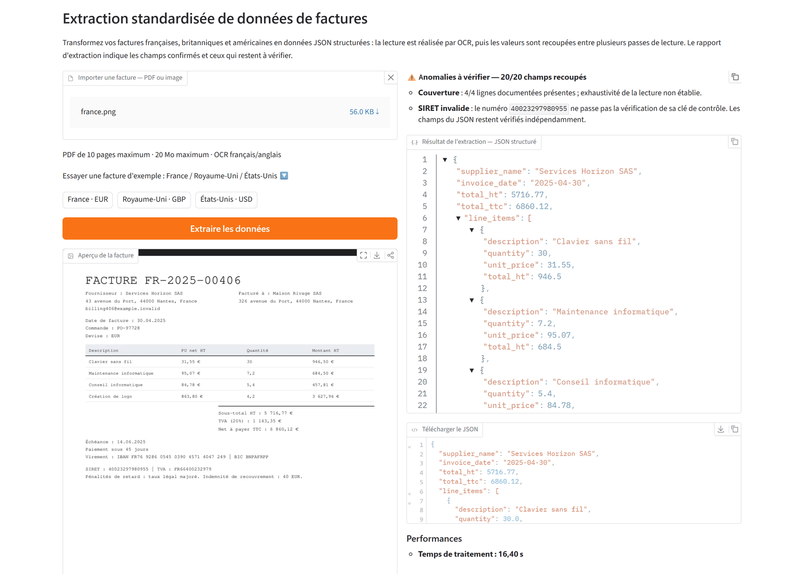

# LLM-extraction-finetune

[](https://www.python.org/) [](https://www.gradio.app/) [](https://tesseract-ocr.github.io/) [](https://opencv.org/) [](https://docs.pydantic.dev/latest/)

## 📖 Description

**LLM-extraction-finetune** est un projet d'extraction automatisée de données de factures PDF et
images, développé en Python. Il transforme des documents français, britanniques et américains en
données JSON structurées grâce à un pipeline OCR combinant analyse documentaire, extraction des
champs et validation des résultats.

Le système identifie fournisseur, date, articles, quantités, prix, taxes et totaux, et rend avec le JSON
un **rapport de vérification** qui distingue ce qui est confirmé, ce qui est anormal et ce qui reste
insuffisamment étayé.

La démo publique fonctionne **sans chargement de modèle de langage** (`INVOICE_MODEL=0`) : seul le
pipeline OCR traite le document. Les visiteurs peuvent téléverser leurs propres factures — PDF, PNG ou
JPEG, 20 Mo au plus — ou partir des exemples fournis. Le document est traité sur l'infrastructure
Hugging Face de l'Espace, et les fichiers créés pour un visiteur restent à l'écart des autres visiteurs
par le contrôle d'accès lié à la session.

**Démo publique — pipeline OCR en ligne :** <https://nicolbl95-llm-extraction-finetune.hf.space>

## 📸 Aperçu de l'interface



*Capture réelle prise après une extraction complète de l'exemple synthétique « France · EUR », dans
la configuration de la démo publique. Fournisseur, client, montants et identifiants y sont fictifs.*

## ✨ Fonctionnalités clés

- **Lecture PDF et image** — jusqu'à 10 pages et 20 Mo, PDF à couche texte native et PDF scanné.
- **OCR positionné** — Tesseract `fra` + `eng` avec coordonnées et confiances ; les prétraitements (redressement, contraste, recadrage, échelle) ne sont escaladés qu'en cas de doute.
- **Devises et écritures régionales** — FR/EUR, UK/GBP et US/USD, dates et numéros traités par locale.
- **Rapport de vérification** — statut champ par champ, anomalies documentaires, contrôle de clé SIRET, JSON exportable.

## 🧠 Architecture du système

```text
Document (PDF, image) → Prétraitement → OCR positionné → Extraction → Vérification → JSON + rapport
```

Chaque étape est un module autonome : prétraitement ([`src/ocr_preprocessing.py`](src/ocr_preprocessing.py)),
preuve documentaire et lignes ([`src/invoice_evidence.py`](src/invoice_evidence.py)), ancrage des montants
([`src/invoice_grounding.py`](src/invoice_grounding.py)), cohérence arithmétique ([`src/invoice_validation.py`](src/invoice_validation.py)),
contrat de sortie ([`data/schema.py`](data/schema.py)) et interface Gradio ([`app/main.py`](app/main.py)).
Détail des étapes et lecture des mesures : [docs/DESIGN.md](docs/DESIGN.md).

**Expérimentation LLM :** le fine-tuning de Qwen2.5-3B par QLoRA sur des factures synthétiques a été exploré ;
le cahier d'entraînement ([`notebooks/fine_tune_unsloth.ipynb`](notebooks/fine_tune_unsloth.ipynb)) et l'évaluateur
([`src/evaluate_finetuned.py`](src/evaluate_finetuned.py)) restent dans le dépôt, exigent un GPU et aucun poids adapté
n'est versionné. Cette approche demeure expérimentale : la démo publique n'exécute que le pipeline OCR et ses règles
de validation.

## 🛠️ Technologies utilisées

**Moteur déployé** (Space et local) :

| Technologie | Rôle |
| --- | --- |
| Python 3.12 | interpréteur déployé par le Space (`python_version: "3.12"`) |
| Gradio 6.30 | interface et serveur ; `app/main.py` est le point d'entrée du Space |
| Tesseract OCR (`pytesseract`) | OCR positionné en TSV, langues `fra` et `eng` |
| OpenCV (headless) | redressement, contraste, recadrage, débruitage, mise à l'échelle |
| PyMuPDF | ouverture et rendu des pages de PDF, couche texte native |
| Pydantic v2 | contrat de sortie et validation stricte |
| Hugging Face Spaces | hébergement de la démo, `requirements.txt` et `packages.txt` |

**Technologies expérimentées** — non exécutées par la démo publique :

| Technologie | Rôle |
| --- | --- |
| Qwen2.5-3B-Instruct | modèle de base adapté par QLoRA, mesuré sur le split de test |
| PyTorch, Transformers, PEFT | entraînement et vérification modèle sur GPU |
| Unsloth | accélération de l'entraînement exploratoire |
| pytest | tests logiciels hors ligne (`requirements-dev.txt`, jamais installée par le Space) |

**Outils de développement** : [Claude Code](https://github.com/anthropics/claude-code), ayant assisté le
développement du projet — aucun composant exécuté par l'application.

## 🚀 Installation locale

Prérequis : **Python 3.12** et **Tesseract** avec les données `fra` **et** `eng`. L'installation Windows
par défaut ne livre qu'`eng` et `osd` ; sans `fra`, Tesseract lit l'anglais sans lever d'erreur.

```powershell
git clone https://github.com/nicolbl95/LLM-extraction-finetune.git
cd LLM-extraction-finetune
python -m venv .venv
.\.venv\Scripts\Activate.ps1
pip install -r requirements.txt
mkdir .venv\tessdata
# copier fra.traineddata et eng.traineddata dans .venv\tessdata : le dépôt ne fournit pas ces binaires
$env:TESSDATA_PREFIX = "$PWD\.venv\tessdata"
& "C:\Program Files\Tesseract-OCR\tesseract.exe" --list-langs   # doit lister eng et fra
$env:INVOICE_MODEL = "0"
python app\main.py
```

`TESSDATA_PREFIX` **remplace** le dossier de langues de l'installation au lieu de le compléter : le
répertoire configuré doit donc contenir `fra` **et** `eng`, les deux langues demandées par le moteur.
L'interface répond sur <http://127.0.0.1:7860> et `INVOICE_MODEL=0` reproduit la démo publique :
OCR déterministe seul.
Sous Linux, `packages.txt` donne les paquets apt et `fra` y est installé. Dépendances réellement importées,
variables d'environnement et commande de référence des tests : [docs/ENVIRONMENT.md](docs/ENVIRONMENT.md).

## 🛡️ Validation et contrôle des erreurs

Une valeur n'est retenue que si le document l'imprime ou la recoupe, et les montants sont recalculés en
arithmétique `Decimal` (quantité × prix unitaire, somme des lignes, net + TVA). Chaque incohérence est
nommée dans le rapport ; un champ incertain sort `null`, sans invention et sans auto-correction par LLM.

## 🧪 Corpus, tests et résultats

**Un test qui passe n'est pas une mesure de précision sur une facture inédite.** Trois registres à ne pas confondre :

| Registre | Ce qui a réellement été exécuté | Résultat |
| --- | --- | --- |
| **Tests logiciels** | 1 328 tests automatisés hors ligne, sans appel de modèle de langage ; 26 réclament les ressources non versionnées, 3 sont marqués `slow` | **1 328 réussis, 26 ignorés, 0 échec, 0 erreur** |
| **Factures synthétiques** | 600 textes et 600 PNG générés pour le développement ([`data/generate_dataset.py`](data/generate_dataset.py)), partitionnés 480 / 60 / 60 ; les tests vérifient leur intégrité | **aucune évaluation d'exactitude sur les 600 documents** |
| **Factures réelles** | une dizaine essayées manuellement dans l'interface ; la validation indépendante exige douze factures annotées à l'aveugle ([`scripts/pr110_ready.py`](scripts/pr110_ready.py)) | **0 / 12** admissibles, donc **aucun taux de précision publié** |

```powershell
pip install -r requirements-dev.txt
python -X utf8 -m pytest -q -p no:cacheprovider tests   # TESSDATA_PREFIX doit rester défini
```

## 👨‍💻 Auteur et développement

Développé par **Nicolas DAVOINE** ([nicolbl95](https://github.com/nicolbl95)), avec l'assistance de
**Claude Code** — démo : <https://nicolbl95-llm-extraction-finetune.hf.space>
