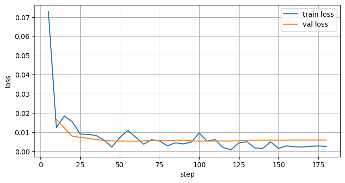

# 🧾 LLM Invoice Extraction & Fine-Tuning

[](https://www.python.org/) [](https://pytorch.org/) [](https://docs.unsloth.ai/) [](https://arxiv.org/abs/2305.14314) [](https://huggingface.co/Qwen/Qwen2.5-3B-Instruct) [](https://docs.pydantic.dev/latest/) [](https://huggingface.co/) [](https://colab.research.google.com/) [](https://docs.reportlab.com/) [](https://github.com/ggml-org/llama.cpp)

## 📖 Description

Extraction de factures internationales **FR/EUR, UK/GBP et US/USD** vers un
JSON structuré : fournisseur, date, articles et totaux. Le projet met en œuvre
les étapes d'un workflow LLM / IA Engineering, de la synthèse de données
jusqu'à la mesure de la qualité d'extraction.

**100 % de validité JSON et 95 % d'Exact Match déclarés dans le rapport v3 :
un résultat remarquable pour Qwen2.5-3B-Instruct, un modèle léger de seulement
3 milliards de paramètres.** Ce résultat illustre l'intérêt d'un fine-tuning
ciblé LoRA/Unsloth pour spécialiser un petit modèle sur une extraction
structurée complexe ; une supériorité sur des modèles plus volumineux reste
à démontrer par un benchmark comparatif.

> **Périmètre : extraction textuelle avec interface documentaire.** La démo
> Gradio accepte les PDF et les images : le texte est lu dans les PDF natifs
> ou extrait par OCR français/anglais avant l'inférence. Le modèle reste
> textuel ; les scores ci-dessus ne mesurent pas la chaîne OCR + extraction.

## Démo live — Gradio

**[Ouvrir la démo sur Hugging Face Spaces](https://huggingface.co/spaces/nicolbl95/LLM-extraction-finetune)**.
L'URL est celle du Space cible ; sa disponibilité dépend du déploiement des
sources et de la configuration des poids décrits ci-dessous.

L'application [app/main.py](app/main.py) propose un upload PDF/PNG/JPEG,
trois exemples cliquables France/EUR, Royaume-Uni/GBP et États-Unis/USD,
un aperçu visuel et le JSON validé par le schéma Pydantic `Invoice`.
Les exemples suivent exactement le même parcours OCR + modèle que les uploads :
aucune réponse attendue du dataset n'est utilisée pour simuler l'extraction.

### Lancement local

Utiliser Python 3.11 ou 3.12, puis installer les dépendances Python et Tesseract
avec les langues française et anglaise (Debian/Ubuntu) :

```bash
sudo apt-get update
sudo apt-get install -y tesseract-ocr tesseract-ocr-fra tesseract-ocr-eng
python -m pip install -r requirements.txt
python app/main.py
```

Ouvrir <http://localhost:7860>. Le modèle est chargé à la première extraction,
pas au démarrage de l'interface. Par défaut, les adaptateurs locaux du run
`results/qwen25-3b-international-v3-20261021T053959288046Z/lora_adapter`
sont chargés sur CUDA en 4 bits s'ils sont présents et complets. Sinon, les
adaptateurs et le tokenizer sont téléchargés automatiquement depuis
[nicolbl95/llm-extraction-weights](https://huggingface.co/nicolbl95/llm-extraction-weights)
et conservés dans le cache Hugging Face. Les poids ne sont pas suivis dans
le dépôt de l'application.

| Variable | Valeur par défaut | Rôle |
| --- | --- | --- |
| `INVOICE_ADAPTER_PATH` | Chemin du run ci-dessus | Dossier des adaptateurs et du tokenizer, absolu ou relatif au dépôt |
| `INVOICE_ADAPTER_REPO` | `nicolbl95/llm-extraction-weights` | Dépôt Hub utilisé lorsque les poids locaux sont absents ou incomplets |
| `INVOICE_ADAPTER_REVISION` | `main` | Branche, tag ou hash de commit du dépôt des poids |
| `HF_TOKEN` | Non défini | Secret de lecture pour un dépôt Hub privé ; inutile pour le dépôt public |
| `INVOICE_DEVICE` | `cuda` | `cuda` (4 bits) ou `cpu` (float32, RAM et latence importantes) |
| `PORT` | `7860` | Port du serveur Gradio |

Le chemin retourné par `snapshot_download` est transmis au backend LoRA après
vérification des fichiers. Le dépôt des poids doit contenir à sa racine
`adapter_config.json`, `adapter_model.safetensors`, `tokenizer_config.json`
et les fichiers du tokenizer (notamment `tokenizer.json` et le template de chat).
Le modèle de base indiqué par les adaptateurs est téléchargé via Transformers
si nécessaire. Un téléchargement échoué ou un dépôt incomplet produit une
erreur explicite ; aucun modèle non fine-tuné ni résultat simulé n'est substitué.

### Hébergement sur Hugging Face Spaces

Créer un Space **Gradio**, sélectionner Python **3.11** et définir dans
l'en-tête YAML du README du Space :

```yaml
---
title: Extraction intelligente de factures
sdk: gradio
sdk_version: 6.30.0
python_version: "3.11"
app_file: app/main.py
---
```

Utiliser la même version Gradio 6.x dans `sdk_version` et dans l'environnement
déployé. Publier les sources, `requirements.txt`, `packages.txt` et
`app/examples/`. Les trois PNG distribuables sont des copies des factures du
split test : France `invoice-0406`, UK `invoice-0110`, US `invoice-0435`.
Ils ne dépendent pas du dossier `data/invoices/`, ignoré par Git.

Prévoir un **Space GPU**. Aucun poids n'a besoin d'être inclus dans le dépôt
du Space : ils sont téléchargés depuis le dépôt Hub configuré. Pour un dépôt
privé, ajouter `HF_TOKEN` dans les **Secrets** du Space ; ne pas l'écrire dans
le code ou le README. Un Space CPU reste possible avec
`INVOICE_DEVICE=cpu`, suffisamment de RAM et une latence plus élevée.
Sur **ZeroGPU**, sélectionner ce matériel dans les paramètres du Space et
conserver `INVOICE_DEVICE=cuda`. Le paquet `spaces` est inclus dans les
dépendances et `predict_invoice` porte le décorateur `@spaces.GPU` :
le chargement du modèle et la génération ont lieu dans la réservation GPU,
tandis que l'OCR et le téléchargement des adaptateurs restent hors de cette
réservation. La validation Pydantic et l'orchestration de l'auto-correction
restent dans le processus Gradio : les erreurs de validation ne traversent
pas la frontière du worker ZeroGPU. Chaque passe réserve le GPU uniquement
pour sa génération. Le décorateur est sans
effet hors de ZeroGPU, ce qui préserve le lancement local et les GPU dédiés.
Le lien ci-dessus pointe vers le Space cible
`nicolbl95/LLM-extraction-finetune`.

Limites de la démo : 20 Mo, 10 pages PDF, 25 mégapixels par image/page rendue,
une extraction à la fois et une file d'attente de 8 requêtes. L'aperçu PDF
montre la première page ; l'extraction lit toutes les pages, avec OCR pour
les pages sans texte. Un document dépassant le contexte du modèle est refusé,
sans troncature silencieuse. Utiliser des factures fictives ou anonymisées ;
les fichiers transitent par le serveur Gradio. La validation Pydantic garantit
la structure, pas l'exactitude métier. Les performances publiées ne sont pas
un benchmark de cette interface ni de son OCR.

## 🛠️ Stack Technique & Méthodologies

- **LLM & Fine-Tuning :** Qwen2.5-3B-Instruct, Unsloth pour l'optimisation
  mémoire/vitesse, adaptation LoRA avec PEFT et quantification 4 bits
  du modèle de base (QLoRA).
- **Structuration & Validation :** Pydantic v2 pour définir le contrat
  d'extraction ; contrôle du JSON strict et validation du schéma après
  génération pour les entités, montants HT/TTC et tableaux d'articles.
  Le pipeline n'impose pas de JSON Schema au décodage.
- **Pipeline de Données :** génération synthétique multilingue et multidevise,
  diversification procédurale des contenus et mises en page (data augmentation),
  partitionnement Train/Val/Test reproductible et contrôles de chevauchement.
- **Évaluation & Métriques :** benchmark personnalisé, Exact Match Rate,
  JSON Validity Rate et rapports `metrics.json`, avec prédictions détaillées
  et ventilation par région, devise, format et template.
- **Environnement & Tooling :** PyTorch, Hugging Face Transformers et Datasets,
  VS Code / GitHub Codespaces pour le développement et Google Colab pour
  l'entraînement GPU.

## 🏗️ Architecture

```text
9 références de templates internationaux
                  │
     Génération procédurale déterministe
                  │
    600 textes + cibles JSON + 600 PNG
                  │
      Train 480 / Validation 60 / Test 60
                  │
      Qwen2.5-3B + QLoRA / Unsloth
                  │
     Adaptateurs LoRA + tokenizer
                  │
   Base + PEFT → JSON → Pydantic / scoring
                  │
       Métriques + prédictions détaillées
```

- **Data Engineering :** neuf familles de structures, 600 profils visuels
  distincts, rendu ReportLab/PyMuPDF, 1 à 12 articles, dates et devises
  régionalisées. Calculs monétaires contrôlés avec `Decimal` et arrondi au
  centime ; seed **42**.
- **Optimisation :** base en 4 bits, supervision des réponses assistant,
  accumulation de gradients et contrôle des longueurs sans troncature
  silencieuse.
- **Fiabilité :** contrat Pydantic v2, scoring du JSON strict, erreurs
  explicites et provenance par hashes. Les splits sont disjoints par ID et
  texte ; les templates restent partagés entre les sous-ensembles.

### Organisation du projet

```text
.
├── assets/loss_curve.png
├── data/
│   ├── generate_dataset.py / render_invoice.py / schema.py
│   ├── dataset.jsonl                  # 600 factures
│   ├── train.jsonl / val.jsonl / test.jsonl
│   ├── templates/                     # 1.png à 9.png
│   └── invoices/                      # 600 rendus PNG uniques
├── notebooks/fine_tune_unsloth.ipynb
├── src/
│   ├── split_data.py
│   ├── evaluate_baseline.py            # baseline Regex, pas Qwen brut
│   └── evaluate_finetuned.py           # LoRA / GGUF
├── tests/                             # données, notebook, évaluation
├── results/
│   ├── evaluation-3/finetuned_metrics.json
│   ├── qwen25-3b-international-v3-20261021T053959288046Z.zip
│   └── qwen25-3b-international-v3-20261021T053959288046Z/
│       ├── lora_adapter/              # poids et tokenizer
│       ├── checkpoints/
│       ├── training_manifest.json
│       ├── train_log.json
│       └── loss_curve.png
├── requirements.txt
└── requirements-inference.txt
```

### Contrat de sortie

Le schéma Pydantic v2 définit `Invoice` et ses `LineItem` :

| Champ | Type | Contenu |
| --- | --- | --- |
| `supplier_name` | `str` | Nom du fournisseur |
| `invoice_date` | `date` | Date normalisée `AAAA-MM-JJ` |
| `total_ht`, `total_ttc` | `float` | Totaux hors taxes et taxes comprises |
| `line_items` | `list[LineItem]` | Articles ordonnés ; liste vide par défaut dans le schéma |
| `line_items[].description` | `str` | Désignation |
| `line_items[].quantity` | `float` | Quantité |
| `line_items[].unit_price` | `float` | Prix unitaire net après remise, hors taxes |
| `line_items[].total_ht` | `float` | Montant net de la ligne |

**Champs extraits ≠ métadonnées.** Client, coordonnées bancaires et références
sont présents dans les documents, mais ne sont pas des champs cibles.
`locale`, `currency`, template, chemin d'image et détails taxes/remises servent
à la traçabilité du dataset, pas au prompt du modèle. Les montants prédits
restent dans la devise du document ; aucun champ `currency` n'est extrait.

## Mécanismes de fiabilisation & déterminisme

### Décodage sans échantillonnage et précision numérique

Le décodage est explicitement verrouillé dans
[src/evaluate_finetuned.py](src/evaluate_finetuned.py) :

- **LoRA / Transformers :** `do_sample=False` pour les deux passes éventuelles.
- **GGUF :** `temperature=0.0` pour la génération.

Dans [app/main.py](app/main.py), le prompt système impose une lecture
littérale des chiffres : une quantité `7,2` doit être transcrite `7.2`,
et non `142` ou `72` ; `4,2` devient `4.2`, et non `42` ou `4.02`.
Les parties entière et décimale doivent être préservées, sans concaténation
ni mélange des colonnes. Les quantités et prix ne doivent pas être déduits
par division des totaux. Un exemple few-shot fictif complet illustre le calcul
`7,2 × 12,50 = 90,00`, soit `quantity=7.2`, `unit_price=12.5`, `total_ht=90.0`.
Les valeurs de cet exemple ne doivent pas être recopiées dans la facture réelle.
Le prompt d'évaluation, identique à celui de l'entraînement, reste inchangé.

### Garde-fous arithmétiques Pydantic

Le schéma partagé [data/schema.py](data/schema.py) valide la structure et
croise les champs numériques avant l'affichage du résultat :

| Contrôle | Règle appliquée |
| --- | --- |
| Cohérence d'une ligne | Comparaison de `quantity × unit_price` avec le `total_ht` de la ligne |
| Cohérence de la facture | Comparaison de la somme des `line_items[].total_ht` avec le `total_ht` global |
| Tolérance monétaire | Détection de tout écart absolu strictement supérieur à **0,02 unité monétaire**, par ligne et sur le total HT global ; avertissement non bloquant dans l'application après l'unique tentative de correction |
| Valeurs non finies | Rejet de `NaN`, `+Infinity` et `-Infinity` dans les quantités, prix et totaux |

Les calculs utilisent `Decimal` à partir des représentations décimales des
valeurs. Le produit quantité × prix unitaire est arrondi au centime avec
`ROUND_HALF_UP`, comme dans le générateur du dataset. Le prix unitaire cible
est le prix **net après remise**. Une facture sans articles signale une
incohérence si son total HT diffère de zéro de plus de 0,02.

**Dans l'application, les écarts arithmétiques ne bloquent plus l'affichage.**
Après l'unique tentative d'auto-correction, le dernier JSON structurellement
valide est rendu avec un bandeau d'avertissement. Celui-ci indique chaque
ligne concernée, la valeur calculée, la valeur extraite et l'écart absolu,
ainsi que toute incohérence du total HT global. Une vérification manuelle
est demandée ; les valeurs ne sont pas recalculées de force.

Le schéma reste **strict par défaut** pour les données, l'évaluation et les
tests Golden. L'application utilise explicitement une validation structurelle
non bloquante sur l'arithmétique pour conserver les résultats exploitables ;
les contrôles numériques sont partagés entre les deux modes.

L'application exige également un objet JSON strict : le texte explicatif,
les balises Markdown et les clés dupliquées ne sont pas acceptés. Les champs
requis, leurs types et les valeurs finies restent obligatoires : un JSON
mal formé ou structurellement invalide n'est pas affiché. Un résultat avec
avertissement n'est pas présenté comme arithmétiquement validé.

**Limites :** le TTC doit être fini, mais son calcul n'est pas vérifié, car
les taux de taxe ne font pas partie du schéma. Le décodage sans échantillonnage
ne garantit ni des résultats identiques entre tous les matériels et versions,
ni l'absence d'hallucinations. Des valeurs erronées mais arithmétiquement
cohérentes nécessitent toujours une vérification du document.

## Boucle d'auto-correction (Self-Correction)

La démo limite la correction à **un unique essai**, soit au maximum
**deux passes d'inférence** :

1. Générer une première réponse, la parser comme JSON strict, puis appliquer
   les validations Pydantic de structure et de cohérence arithmétique.
2. Si le JSON est mal formé ou échoue à Pydantic, conserver la facture
   originale et ajouter à la conversation **le JSON erroné et l'erreur exacte
   du parseur ou de Pydantic**, avec les champs et incohérences signalés.
3. Demander une correction ciblée respectant les valeurs littérales de la
   facture, notamment les décimales. En présence d'écarts arithmétiques,
   transmettre les anomalies de chaque ligne et du total, puis donner priorité
   à la relecture des champs `quantity` et `unit_price` net après remise.
   Seules les valeurs confirmées dans le texte source doivent être corrigées,
   avant de relire les totaux, sans les recalculer artificiellement pour
   satisfaire la validation.
4. Revalider la seconde réponse. Si sa structure est valide mais ses calculs
   restent incohérents, afficher son JSON avec les avertissements détaillés.
   Si elle est inutilisable ou si cette seconde inférence échoue, conserver
   le premier JSON structurellement valide avec ses avertissements et le motif
   d'échec de la correction. En l'absence de tout JSON structurellement valide,
   afficher l'erreur et laisser le résultat vide.
   **Aucune troisième tentative n'est lancée.**

Les erreurs de chargement, réponses tronquées et dépassements du contexte
ne déclenchent pas cette correction. Si ces erreurs surviennent pendant la
seconde passe, elles n'effacent pas le premier résultat structurellement valide.
Le contexte reste limité sans troncature silencieuse, y compris pendant la
seconde passe.

Sur ZeroGPU, seules les opérations de chargement et de génération du modèle
sont exécutées dans `predict_invoice`, décorée avec `@spaces.GPU`. La
validation et l'orchestration des deux passes restent dans le processus
Gradio, afin de préserver les erreurs Pydantic sans les faire traverser
la frontière du worker GPU.

## 🎯 Résultats clés

| Indicateur | Résultat |
| --- | ---: |
| Validité JSON déclarée | **100 %** |
| Exact Match déclaré | **95 %** |
| Dataset international v3 | **600 factures + 600 PNG** |
| Répartition par région | **200 FR / 200 UK / 200 US** |
| Split train / validation / test | **480 / 60 / 60** |

Source : [rapport final v3](results/evaluation-3/finetuned_metrics.json),
qui identifie les adaptateurs du run Colab. Ce rapport synthétique ne fournit
ni effectif évalué, ni hash du test, ni latence, ni détail par segment :
les deux taux sont repris tels que déclarés, sans extrapolation.

L'évaluateur prépare les ventilations région/devise/format/template et distingue
JSON strict, validité du schéma et exactitude métier. Il compare les nombres
avec une tolérance de **0,01** et les articles dans leur ordre. Les rapports
historiques Regex/GGUF ne constituent pas une comparaison contrôlée v3.

## 🚀 Fine-tuning & Loss

Entraînement QLoRA réalisé sur Colab avec Unsloth ; les poids LoRA et le
tokenizer sont importés dans `results/`.

| Configuration | Valeur |
| --- | --- |
| Base | `unsloth/Qwen2.5-3B-Instruct` |
| Quantification / LoRA | 4 bits ; rang `16`, alpha `16` |
| Époques / learning rate | `3` / `2e-4` |
| Batch / accumulation | `1` / `8` |
| Contexte maximal | `4096` tokens |
| Durée du run | Environ **40 min 19 s** |
| Train loss / validation loss | **0,00746 / 0,00591** |



La perte diminue rapidement puis reste faible ; la validation se stabilise
autour de **0,006**, sans remontée durable visible. Cela suggère une convergence
stable sur ce run, sans prouver l'absence de surapprentissage.

Pour reproduire : ouvrir le notebook sur un GPU compatible (Colab T4 prévu),
fournir les fichiers v3 `train.jsonl` et `val.jsonl`, puis exécuter les cellules
dans l'ordre. Le manifeste sauvegarde configuration, versions et hashes ;
l'archive doit être téléchargée avant expiration du runtime.
**Les adaptateurs nécessitent le modèle de base.** L'export GGUF fusionné
Q4_K_M est facultatif ; les uploads Hub/W&B sont désactivés par défaut.

## ⚙️ Installation & Utilisation

### 1. Installation

```bash
python -m venv .venv
source .venv/bin/activate
pip install -r requirements.txt
pip install -r requirements-inference.txt  # Pour l'inférence et l'évaluation
```
